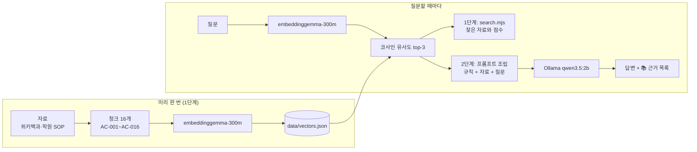

# 학원 학습코칭 안내 챗봇: 내 PC에서 끝나는 RAG 2단계

학원 학생이 공부 방법(시험 계획, 오답노트, 복습 주기, 집중법)과 학원 규칙(결석·보강)을 물으면, **학원 학습코칭 SOP와 위키백과**를 근거로 답하는 챗봇입니다. 서버·웹 화면 없이 PowerShell에서 실행하는 Node.js 프로그램이며, 모든 계산이 내 PC 안에서 이루어집니다.

- **답하는 것:** 학원 학습코칭 SOP(시험 대비 계획, 오답노트 관리, 결석과 보강, 시험 기간 학원 운영, 공부하는 이유)와 학습 관련 공개 지식(망각 곡선, 간격 반복, 메타인지, 포모도로 기법, 기억, 수면)
- **답하지 않는 것:** 학생 개인의 성적·출결·숙제 현황. 이런 질문은 담당 선생님께 확인하도록 안내합니다.

> 과제 가이드 「물류창고 재고 조사 안내 챗봇: 내 PC에서 끝나는 RAG 2단계」를 **학원 학습코칭 도메인**으로 바꿔 진행했습니다. 구조와 계약은 가이드와 같고, 청크 ID만 `WH-` 대신 `AC-`(ACademy)를 씁니다.

## 동작 원리



1. 자료를 "사실 하나"씩 잘라 청크 16개를 만들고, 청크마다 출처(url)를 붙입니다.
2. 청크를 임베딩 모델로 768개 숫자(벡터)로 바꿔 `data/vectors.json`에 저장합니다.
3. 질문도 같은 모델로 벡터로 바꾼 뒤, 모든 청크와 내적(= 코사인 유사도)을 계산해 상위 3개를 고릅니다. **여기까지가 1단계**입니다.
4. 찾은 청크와 규칙(근거로만 답하기, 출처 ID 표시)을 질문과 함께 프롬프트로 조립합니다.
5. 로컬 LLM이 답을 스트리밍으로 만들고, 프로그램이 넘긴 자료를 📚 근거 목록으로 보여 줍니다. **여기까지가 2단계**입니다.

## 사용 기술

| 구분 | 내용 |
|---|---|
| 실행 | Node.js v24, ES 모듈(`src/*.mjs`), 의존성은 `@huggingface/transformers` 4.3.1 하나 |
| 임베딩 | `onnx-community/embeddinggemma-300m-ONNX`, dtype `q8`, mean pooling + 정규화, 768차원 |
| 입력 형식 | 문서 `title: 섹션 \| text: 본문`, 질문 `task: search result \| query: 질문` (모델 공식 형식) |
| LLM | Ollama `qwen3.5:2b`, `/api/chat`, `stream: true`, `think: false`, `temperature: 0` |

## 실행 방법

```powershell
ollama pull qwen3.5:2b
npm install
node src/build-index.mjs
node src/search.mjs "망각 곡선이 뭐야?"
node src/ask.mjs "결석하면 보강은 언제까지 신청해야 해?"
```

| 명령·옵션 | 설명 |
|---|---|
| `node src/build-index.mjs` | `data/chunks.json` → `data/vectors.json`. 청크를 고친 뒤에는 다시 실행 |
| `node src/search.mjs "질문1" "질문2" [--k 3]` | 1단계: 비슷한 청크를 점수 막대와 함께 표시, 1위가 0.55 미만이면 ⚠ |
| `node src/ask.mjs "질문"` | 2단계: 🔎 검색 결과 → 💬 답변(스트리밍) → 📚 근거 → ⏱ 시간 |
| `--k 5` | 검색해서 넘길 청크 수 (기본 3) |
| `--show-prompt` | LLM에 보낼 system/user 메시지만 출력 (Ollama 없이 동작) |
| `--no-rag` | 검색과 시스템 메시지 없이 질문만 LLM에 보냄 (비교 실험용) |

첫 실행은 임베딩 모델(약 300MB)을 내려받느라 2분 정도 걸립니다. 한글이 깨지면 `[Console]::OutputEncoding = [Text.Encoding]::UTF8`를 먼저 실행하세요.

## 자료

| id | section | 출처 | 글자 수 |
|---|---|---|---|
| AC-001 | 망각 곡선 | [위키백과: 망각 곡선](https://ko.wikipedia.org/wiki/%EB%A7%9D%EA%B0%81_%EA%B3%A1%EC%84%A0) | 218 |
| AC-002 | 간격 효과 | [위키백과: 망각 곡선](https://ko.wikipedia.org/wiki/%EB%A7%9D%EA%B0%81_%EA%B3%A1%EC%84%A0) | 200 |
| AC-003 | 간격 반복 | [위키백과: 간격 반복](https://ko.wikipedia.org/wiki/%EA%B0%84%EA%B2%A9_%EB%B0%98%EB%B3%B5) | 179 |
| AC-004 | 라이트너 시스템 | [위키백과: 간격 반복](https://ko.wikipedia.org/wiki/%EA%B0%84%EA%B2%A9_%EB%B0%98%EB%B3%B5) | 183 |
| AC-005 | 메타인지 | [위키백과: 메타인지](https://ko.wikipedia.org/wiki/%EB%A9%94%ED%83%80%EC%9D%B8%EC%A7%80) | 126 |
| AC-006 | 포모도로 기법 | [위키백과: 포모도로 기법](https://ko.wikipedia.org/wiki/%ED%8F%AC%EB%AA%A8%EB%8F%84%EB%A1%9C_%EA%B8%B0%EB%B2%95) | 240 |
| AC-007 | 단기 기억 | [위키백과: 기억](https://ko.wikipedia.org/wiki/%EA%B8%B0%EC%96%B5) | 231 |
| AC-008 | 덩이짓기(청킹) | [위키백과: 기억](https://ko.wikipedia.org/wiki/%EA%B8%B0%EC%96%B5) | 142 |
| AC-009 | 수면 부족과 기억 | [위키백과: 잠](https://ko.wikipedia.org/wiki/%EC%9E%A0) | 135 |
| AC-010 | 수면과 장기 기억 | [위키백과: 잠](https://ko.wikipedia.org/wiki/%EC%9E%A0) | 244 |
| AC-011 | 자기주도적 학습 | [위키백과: 자기주도적 학습](https://ko.wikipedia.org/wiki/%EC%9E%90%EA%B8%B0%EC%A3%BC%EB%8F%84%EC%A0%81_%ED%95%99%EC%8A%B5) | 231 |
| AC-012 | 시험 대비 계획 | [docs/sop.md#시험-대비-계획](docs/sop.md#시험-대비-계획) | 135 |
| AC-013 | 오답노트 관리 | [docs/sop.md#오답노트-관리](docs/sop.md#오답노트-관리) | 125 |
| AC-014 | 결석과 보강 | [docs/sop.md#결석과-보강](docs/sop.md#결석과-보강) | 137 |
| AC-015 | 시험 기간 학원 운영 | [docs/sop.md#시험-기간-학원-운영](docs/sop.md#시험-기간-학원-운영) | 140 |
| AC-016 | 공부하는 이유 | [docs/sop.md#공부하는-이유](docs/sop.md#공부하는-이유) | 190 |

**청크 설계 원칙**
1. **한 청크에 사실 하나.** 주제가 섞이면 엉뚱한 질문에도 걸립니다. 예를 들어 망각 곡선 문서는 "정의"(AC-001)와 "간격 효과"(AC-002)로 나눴습니다.
2. **혼자 읽어도 뜻이 통하게.** 앞 문맥이 필요한 문장으로 시작하지 않습니다.
3. **원문에 없는 말을 보태지 않기.** 위키 청크는 위키백과 공식 API(2026-10-14)로 받은 원문에서 시작·끝 구절 사이를 **글자 그대로** 잘랐습니다.

**출처 대조 (2026-10-14):** 위키 청크 11개의 url을 실제로 열어, 청크의 문장 26개가 페이지 본문에 그대로 있는지 문장 단위로 대조했습니다. 11개 모두 HTTP 200, 넘겨주기 없이 해당 문서가 열렸고, **문장 26개가 모두 원문과 일치**했습니다(띄어쓰기와 각주 번호 `[47]` 같은 표시는 비교에서 제외). SOP(`docs/sop.md`)는 **우리 학원의 실제 기준**을 원장이 답한 내용 그대로 정리한 문서입니다(학원 이름·연락처는 넣지 않음). 처음에는 교육용 예시로 시작했고, 확인되지 않은 예시 문장은 모두 지웠습니다.

## 1단계 관찰 기록 (STEP 5)

2026-10-14 측정(SOP를 실제 학원 기준으로 고친 최종 자료), 16청크, embeddinggemma-300m q8, 각 질문 상위 3개.

| # | 질문 | 유형 | 1위 | 점수 | 2위 | 관찰 |
|---|---|---|---|---|---|---|
| 1 | 시험 4주 전에는 뭘 해야 해? | 정상 | AC-012 시험 대비 계획 | 0.744 | AC-015 0.649 | 정확히 찾음. 2위도 관련 있는 시험 기간 운영 |
| 2 | 틀린 문제는 어떻게 정리해? | 다른 표현 | AC-013 오답노트 관리 | 0.685 | AC-004 0.547 | **"오답노트"라는 단어가 없어도** 같은 청크를 찾음 |
| 3 | 망각 곡선이 뭐야? | 정상 | AC-001 망각 곡선 | 0.708 | AC-002 0.636 | 같은 문서에서 나눈 두 청크가 1·2위 |
| 4 | 포모도로 기법이 뭐야? | 정상 | AC-006 포모도로 기법 | 0.670 | AC-011 0.532 | 1·2위 차이가 큼 |
| 5 | 공부할 때 집중이 안 되면 어떻게 해? | 경계 | AC-002 간격 효과 | 0.611 | AC-014 0.603 | **포모도로 기법(AC-006)이 상위 3개에 없음.** 1~3위 차이가 0.03으로 뚜렷한 1위가 없음 |
| 6 | 시험 전날 밤새서 공부해도 돼? | 경계 | AC-012 시험 대비 계획 | 0.645 | AC-015 0.625 | **수면 청크(AC-009, AC-010)가 상위 3개에 없음.** "시험" 단어에 끌림 |
| 7 | 내 지난주 수학 숙제 점수 몇 점이야? | 도메인 밖 | AC-014 결석과 보강 | 0.608 | AC-013 0.608 | **자료에 없는 개인 정보인데 기준(0.55)을 넘어 ⚠가 안 뜸.** 1~3위가 0.606~0.608로 거의 같음 |
| 8 | 내일 날씨 어때? | 무관 | AC-014 결석과 보강 | 0.495 ⚠ | AC-004 0.424 | 무관하면 점수가 낮아짐 |
| 9 | 김치찌개 레시피 알려줘 | 무관 | AC-008 덩이짓기 | 0.416 ⚠ | AC-006 0.411 | 1~3위가 모두 0.40 안팎으로 비슷 |
| 10 | 공부 왜 해야 돼요? | 정상 (SOP 추가 후) | AC-016 공부하는 이유 | 0.781 | AC-011 0.578 | 자료를 넣기 전에는 1위가 자기주도적 학습 0.578이었음 |

**자료를 바꿀 때 생긴 변화 (같은 질문, SOP 수정 전 → 후)**
- 6번 "밤새도 돼?": 수정 전에는 2위가 **수면과 장기 기억 0.561**이었는데, 학원 SOP 청크가 늘자 상위 3개에서 빠졌습니다. 자료를 추가하면 상관없어 보이는 질문의 결과도 바뀝니다.
- 7번 "숙제 점수": 0.659 → 0.608로 내려갔지만 여전히 기준 위입니다.

### 🧠 생각해 볼 것

1. **2번처럼 단어가 겹치지 않아도 찾을 수 있는 이유는?** 임베딩은 글자가 아니라 뜻을 숫자로 바꿔 비교합니다. "틀린 문제를 정리"와 "오답노트에 옮긴다"는 뜻이 가까워서 벡터도 가깝습니다.
2. **8·9번도 1위 청크는 항상 나온다.** 검색은 "가장 가까운 것"을 고를 뿐이고 "답이 있는지"는 모릅니다. 그래서 0.55 같은 기준점이 필요합니다.
3. **7번은 기준을 통과해 버린다.** "숙제 점수"는 자료에 없지만 학원 관련 단어가 많아 0.608이 나왔습니다. 점수만으로는 "개인 현황은 자료에 없다"를 걸러낼 수 없으므로, 2단계에서 시스템 메시지로 규칙을 알려 줘야 합니다.
4. **5번처럼 기대한 청크가 안 나오기도 한다.** "집중"이라는 단어가 포모도로 청크에 있는데도 3위 밖이었습니다. 질문이 짧고 막연하면 1~3위 점수가 비슷해지고, 이럴 때 LLM에 넘어가는 자료는 질문과 덜 맞습니다.

## 2단계 비교 실험 기록 (STEP 8)

최종 자료(SOP 5절, 청크 16개)와 최종 시스템 메시지로 2026-10-14 12:42~12:44에 실행했습니다. `qwen3.5:2b`, temperature 0, 생각 모드 끔, CPU 실행. "RAG 없이"는 검색과 시스템 메시지를 모두 빼므로 자료와 상관없어, A~D는 11:00~11:47에 실행한 결과를 그대로 씁니다. 원문은 [`실험/실행기록/`](실험/실행기록)에 있습니다.

| 질문 | RAG 없이 (핵심 문장) | RAG (핵심 문장) | [AC-xxx] 표시 | 지어낸 내용? | 내 판단 |
|---|---|---|---|---|---|
| A 오답노트는 어떻게 써? | "오답노트(Error Notebook)는 일반적으로 **AI 모델의 오류를 기록**하고 분석하여…" (175.7초) | "학원에서 정한 오답노트 형식에 맞춰 정리합니다. 담당 선생님은 일주일에 두 번, 수업 시간 중에 학생의 오답노트를 확인합니다. (AC-012)" (42.1초) | 잘못 표시: 내용은 AC-013인데 **AC-012**로 적음, ✓ 없음 | RAG 없음: **오답노트를 AI 도구로 오해.** RAG: 내용은 SOP 그대로, ID만 틀림 | RAG 없이는 학생에게 엉뚱한 설명을 해 줄 뻔했다. RAG는 우리 학원 방식(학원 형식, 주 2회 확인)을 정확히 말했다. 출처 ID가 틀려도 근거 목록이 걸러 주니 그대로 써도 된다. |
| B 결석하면 보강은 언제 가면 돼? | "결석(치아를 빠뜨리는 경우)은… **보강을 위해 반드시 치과에 방문**해야 합니다" (108.2초) | "결석한 수업은 토요일 보강으로 채운다. 보강은 매주 토요일 오전 10시부터 오후 3시 사이에 학원에 오면 된다. (AC-014)" (24.7초) | ✓ AC-014 | RAG 없음: "결석"을 치아 문제로 오해. RAG: 없음 | 학생이 가장 많이 묻는 질문인데 RAG가 시간까지 정확히 답했다. 학원 규칙 안내는 챗봇에 맡겨도 되겠다. |
| C 내 지난주 수학 숙제 점수 몇 점이야? | "개인적인 정보나 과거의 성적 기록을 확인할 수 없다"고 거절 (19.9초) | "담당 선생님이나 학원 카카오톡으로 확인해 주세요." (16.2초) | 없음 | 둘 다 없음 | 점수를 지어내지 않고 우리 학원 연락 방법으로 안내했다. 학생 개인 기록은 챗봇이 다루지 않는다는 원칙이 지켜졌다. |
| D 내일 날씨 어때? | "실시간 날씨 정보를 제공하지 못한다, 검색 엔진에서 확인하라" (21.2초) | "내일은 2026년 10월 15일 **(수요일)**입니다. … 날씨 관련 정보가 없어요. 담당 선생님이나 학원 카카오톡으로 확인해 주세요." ⚠ (26.0초) | 없음 | RAG: **요일을 틀리게 지어냄**(10월 15일은 목요일). 날씨를 선생님께 확인하라는 엉뚱한 안내 | 날씨처럼 학원과 상관없는 질문에는 오히려 RAG 없는 답이 자연스러웠다. 작은 모델은 날짜 계산을 믿으면 안 된다. |
| E 공부 왜 해야 돼요? | "개인 성장과 자기계발, 미래 준비와 기회…" 일반론을 길게, 중간에 중국어(结识)가 섞임 (90.6초) | "공부를 해야 하는 이유는 세 가지다. 첫째, 지금 속해 있는 곳에서 최선을 다하는 것이 학생의 몫이다. 둘째, … 나만의 공부법을 터득한다. 셋째, … 새로운 것을 알아갈 수 있다." (29.7초) | 없음 (✓ 없음, 내용은 AC-016) | 둘 다 없음 | 내가 학생들에게 하는 말 그대로 답했다. 일반론보다 짧고 분명해서 학원 챗봇다운 답이다. |

**관찰 메모 (사실)**
- 학원 고유 내용(A·B·E)에서 RAG의 효과가 가장 컸습니다. RAG 없이는 오답노트를 AI 도구로, 결석을 치아 문제로 오해했고, "공부 왜"에는 일반론을 늘어놓았습니다. RAG로는 SOP 문장을 그대로 답했고, 답 시간도 90~176초에서 25~42초로 줄었습니다(답이 짧아서).
- **A에서 출처 ID를 두 번 모두 `AC-012`로 틀렸습니다**(SOP 수정 전 11:00, 수정 후 12:42). 내용은 AC-013인데 프롬프트의 예시 ID `[AC-012]`를 그대로 따라 쓴 것으로 보입니다. 📚 근거는 프로그램이 직접 만들기 때문에 ✓가 붙지 않고 "ID 표시가 없습니다"가 나와, 틀린 인용을 걸러냈습니다.
- **D에서 모델이 날짜를 지어냈습니다.** 프롬프트 ④에 "2026년 10월 14일 수요일"을 넣었는데 "내일은 10월 15일 (수요일)"이라고 답했습니다. 묻지 않은 날짜를 말한 것도, 요일을 틀린 것도 문제입니다(가이드 STEP 8 선택 실험 "시각 말하기 버릇 고치기"와 같은 현상).
- 답의 말투: 시스템 메시지에 "존댓말"을 넣었지만, SOP 문장("~한다")을 그대로 옮기면서 반말체가 섞였습니다(B·E).

### 실험: 시스템 메시지 바꿔 보기 (가이드 STEP 8 선택)

처음 초안과 최종 시스템 메시지를 **같은 SOP**로 비교했습니다(초안 11:00·11:47, 최종 12:27, 원문 `STEP8_시스템메시지v2_*.txt`). 최종 메시지에서 바꾼 것은 ① 학습코치·초등중등·단호하게 답할 경우를 정함 ② "자료에 시간·날짜·횟수가 있으면 빠짐없이" ③ 할 말을 따옴표로 직접 적음, 세 가지입니다.

| 질문 | 초안 | 최종 | 효과 |
|---|---|---|---|
| B 보강은 언제 가면 돼? | "토요일 보강으로 채운다" (**시간 빠짐**) | "…매주 토요일 오전 10시부터 오후 3시 사이에 학원에 오면 된다" | ✅ ② 규칙으로 숫자를 빠뜨리지 않음 |
| C 내 숙제 점수? | "제가 가진 자료에는 없습니다" (**안내 빠짐**) | "담당 선생님이나 학원 카카오톡으로 확인해 주세요." | ✅ ③ 따옴표로 적은 문장을 그대로 씀 |
| D 내일 날씨? | "제가 가진 자료에는 없습니다" | "…다루어지지 않았습니다. 담당 선생님이나 학원 카카오톡으로 확인해 주세요." | △ 개인 기록용 안내를 날씨에도 씀 |
| E 공부 왜 해야 돼요? (자료 추가 전) | — | "망각이 학습 직후 20분 내에 41.8% 발생하기 때문에…" | ❌ 자료가 없자 **망각 곡선 청크를 억지로 "공부하는 이유"로 엮음.** 1위 점수 0.578로 ⚠도 안 뜸 → SOP에 "공부하는 이유"를 넣어 해결 |

작은 모델에게는 "안내하라" 같은 지시보다 **실제로 할 말을 따옴표로 주는 것**이 잘 통했습니다. 반면 자료에 없는 질문은 시스템 메시지만으로 막지 못했고, 자료를 넣어야 해결됐습니다.

## 설계 결정

| 결정 | 이유 |
|---|---|
| 도메인을 학원 학습코칭으로 변경 | 실제로 운영하는 학원에 쓸 수 있는 주제. 가이드의 구조(SOP + 위키, 비목표, 도메인 밖 질문)를 그대로 옮길 수 있음 |
| 비목표에 "개인 성적·출결·숙제 조회" | 가이드의 "실시간 재고 수량(WMS)"에 해당. 학생 개인정보는 챗봇이 아니라 학원 관리 시스템과 담당 선생님이 다룸 |
| 위키 청크는 원문을 기계적으로 잘라 만듦 | "원문에 없는 말을 보태지 않기"를 사람 눈이 아니라 코드로 보장하기 위해 |
| 시스템 메시지는 원장이 정한 성격으로, 할 말은 따옴표로 | 학습코치, 존댓말, 초등·중등 대상, 학원 규칙과 공부를 피하려는 질문에는 단호하게. 2B 모델이 규칙을 빠뜨려서 실제 안내 문장을 그대로 적음 (위 실험) |
| SOP에 "공부하는 이유"를 원장 말로 추가 | 자료가 없을 때 모델이 관련 없는 청크를 엮어 답했기 때문 (실험 E) |
| 시스템 메시지의 예시 ID `[AC-012]` | 가이드 형식을 따름. 단 실험 A에서 모델이 이 예시 ID를 두 번 모두 그대로 베껴, 다음에는 자료에 없는 ID(예: `[AC-000]`)를 예시로 쓰는 실험을 해 볼 만함 |

## 한계와 다음 단계

- **2B 모델의 한계:** 출처 ID를 프롬프트 예시대로 베끼고(A), 묻지 않은 날짜를 틀리게 말하고(D), SOP의 "~한다" 말투를 그대로 옮깁니다. 그래서 근거 목록은 프로그램이 따로 보여 줍니다.
- **검색만으로는 "답이 없음"을 판단하기 어렵습니다:** 학원 단어가 많은 개인 정보 질문(숙제 점수)이 0.608로 기준(0.55)을 넘었습니다. 이번에는 시스템 메시지가 막았지만, 기준점 하나로는 막을 수 없습니다.
- **자료가 늘면 다른 질문의 결과가 바뀝니다:** SOP를 늘리자 "밤새도 돼?"에서 수면 청크가 상위 3개 밖으로 밀려났습니다. 자료를 바꿀 때마다 STEP 5 질문을 다시 돌려 봐야 합니다.
- **막연한 질문에 약합니다:** "집중이 안 되면?"처럼 짧은 질문은 1~3위 점수 차이가 거의 없고, 기대한 청크(포모도로)가 빠졌습니다.
- **다음에 해 볼 것**
  - STEP 5 선택 심화인 BM25 하이브리드 검색. 이전에 Python으로 만든 버전에서 문서 6개, 질문 16개 기준 Hit@3이 키워드 검색 81%에서 하이브리드 100%로 올랐습니다.
  - 프롬프트 예시 ID를 `[AC-000]`으로 바꾸기, ④ 시각 문장에 "날짜·시간을 묻지 않으면 말하지 않는다" 추가 (가이드 STEP 8 선택)
  - 위키 청크를 초등·중등 학생이 읽기 쉬운 학원 자료로 바꾸기, 대화형 모드
